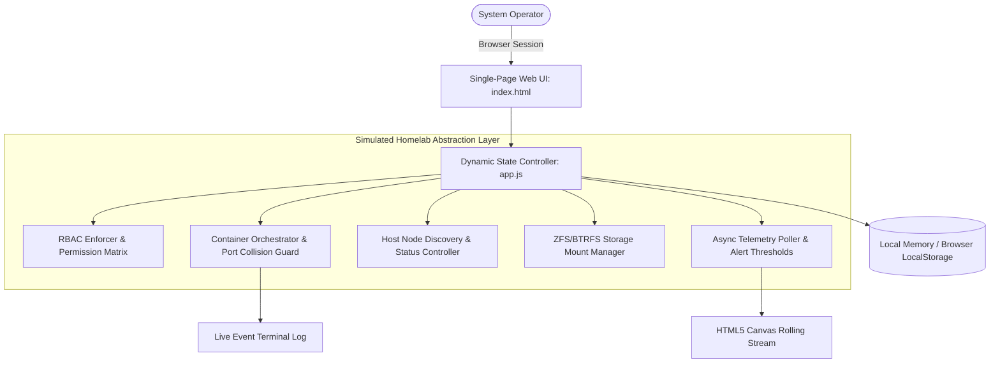
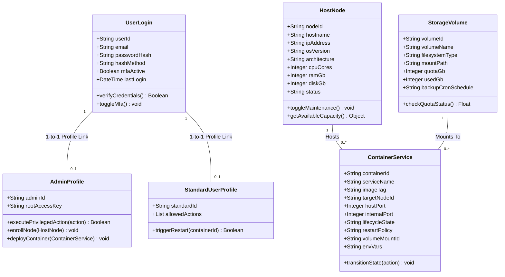
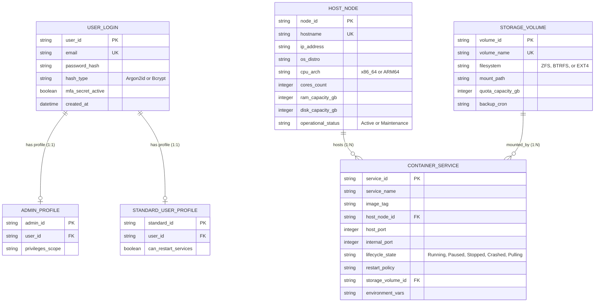
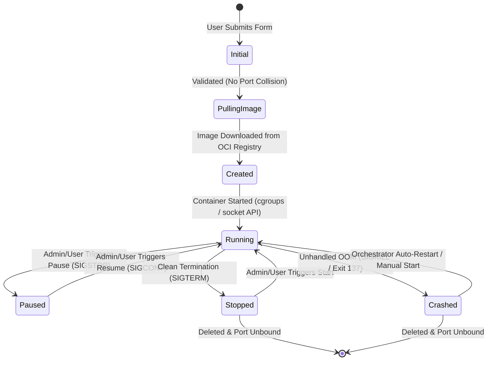
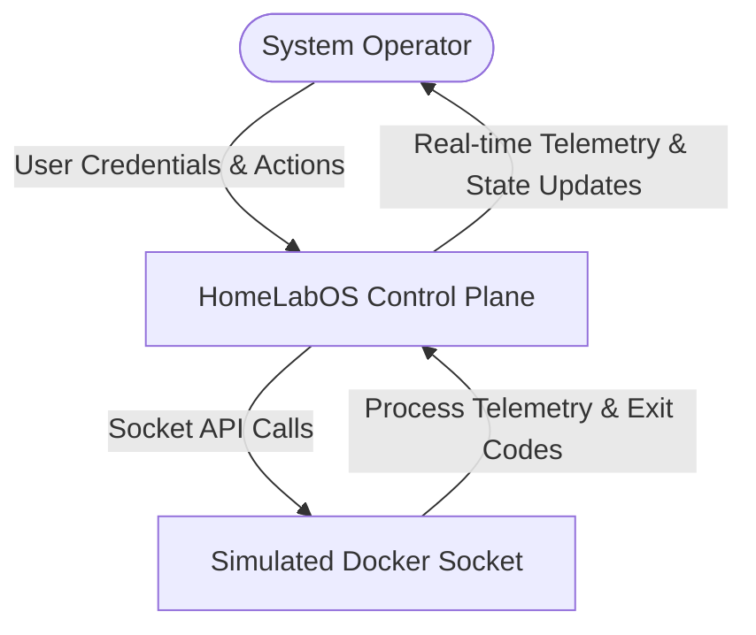
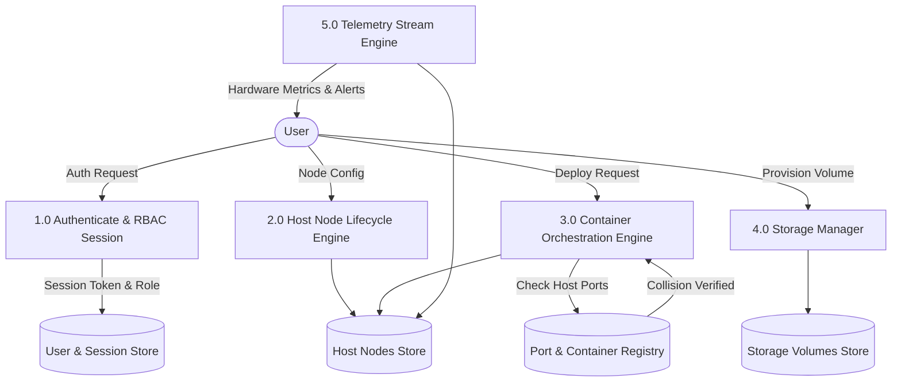
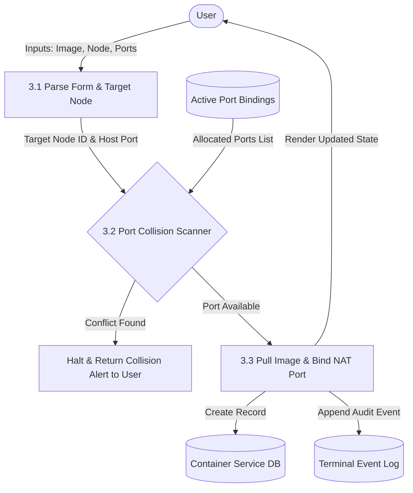

# HomeLabOS: Production-Grade Infrastructure Management System (Proof-of-Concept)

[](https://pages.github.com/)
[](#)
[](#)
[](#)

A modern, responsive, zero-dependency single-page proof-of-concept control plane for bare-metal and virtualized homelab servers. It abstracts Linux node discovery, Docker/Podman container lifecycle orchestration, storage pool datasets (ZFS/BTRFS/EXT4), NAT port collision prevention, real-time telemetry polling, and Role-Based Access Control (RBAC).

---

## 📑 Core Functional Modules

| Module | Features & Capabilities |
| :--- | :--- |
| **1. Telemetry Dashboard** | Live multi-line HTML5 `<canvas>` rendering of fluctuating CPU, RAM, and Network I/O metrics; safety threshold alert triggers (>85% load); interactive event audit terminal drawer; quick container snapshot. |
| **2. Host Node Management** | Overview of heterogeneous server nodes (Ubuntu, Debian, TrueNAS across `x86_64` and `ARM64`); real-time core/RAM/disk capacity gauges; interactive **Active** &harr; **Maintenance** mode switcher. |
| **3. Container Orchestration** | Service lifecycle management (`Running`, `Paused`, `Stopped`, `Crashed`, `Pulling`); one-click lifecycle actions (Start, Pause, Resume, Stop, Crash Simulation, Destroy); image deployment modal with application presets (Nginx, Pi-hole, Plex, Nextcloud). |
| **4. Storage & Volume Pools** | Overview of ZFS datasets (`RAID-Z2`), BTRFS subvolumes, and EXT4 mount paths; dynamic quota usage visualization; container volume bindings; pool provisioning modal. |
| **5. Network & Port Registry** | Centralized NAT port mapping table (`80:80`, `53:53`, `32400:32400`); real-time port collision engine that actively halts deployment if a requested external port is already allocated on the target host. |
| **6. RBAC & Security** | Simulated authentication profiles for **Admin** (`Alex Vance`, Argon2id hash, TOTP active) and **Standard User** (`Jordan Lee`, Bcrypt hash); dynamic UI permission toggling; enforced authorization matrix preventing unauthorized destructive actions. |

---

## 🏛️ Software Engineering Specification & Diagrams

### 1. Architectural Overview & Context
HomeLabOS decouples the browser-based control plane from underlying daemon agents. In this client-side architecture, the central state engine interacts with a virtualized host agent abstraction, storing changes to `localStorage` for complete data persistence across browser reloads.



---

### 2. UML Class Diagram
The system structure enforces clean separation between User Authentication profiles, Host Nodes, Container Services, and Storage Volumes.



---

### 3. Entity-Relationship (ER) Diagram
Primary and Foreign Key relational schema mapped across entities:



---

### 4. Container Service Lifecycle Statechart Diagram
Models the valid state transitions for containerized applications running on the orchestration engine:



---

### 5. Data Flow Diagrams (DFDs)

#### Level 0 DFD (Context Diagram)


#### Level 1 DFD (Decomposed Subsystems)


#### Level 2 DFD (Container Deployment & Port Collision Validation)


---

## 🧪 Comprehensive Verification & Test Plan

The system has been evaluated against test suites verifying functional accuracy, security boundaries, and lifecycle resilience:

| Test ID | Module | Test Description | Expected Result | Status |
| :---: | :--- | :--- | :--- | :---: |
| **TC-01** | **RBAC** | Attempt to register a host node while switched to **Standard User** role. | System blocks modal, logs security alert to terminal, and displays access denial toast. | **PASS** |
| **TC-02** | **RBAC** | Switch session from Standard User to **Admin** via top-right menu. | All administrative actions unlocked, profile pill changes to red ADMIN, Argon2id verified. | **PASS** |
| **TC-03** | **Network** | Deploy a new service on `node-01` requesting external port `80` (already bound to Nginx). | Port Collision Scanner immediately flags port 80 in red text and disables deployment. | **PASS** |
| **TC-04** | **Container** | Trigger `Pause` and subsequent `Resume` on running container. | Container transitions to `Paused` (amber badge) and returns to `Running` (emerald badge). | **PASS** |
| **TC-05** | **Container** | Trigger `Crash` simulation on `prometheus-exporter`. | Container moves to `Crashed` state (rose badge, exit code 137), alert logged to terminal. | **PASS** |
| **TC-06** | **Nodes** | Toggle host node `node-01` into **Maintenance Mode**. | Node status reflects `Maintenance`, card receives amber glow, containers excluded from deploy. | **PASS** |
| **TC-07** | **Storage** | Provision new ZFS storage dataset `/mnt/tank/vault` with 1000 GB quota. | Storage pool card renders with real-time usage bar and automated backup cron schedule. | **PASS** |
| **TC-08** | **Telemetry** | Click "Simulate Heavy Spike" in terminal drawer. | CPU and RAM jump to >90%, dynamic Alert Banner fires, and canvas curves update in real-time. | **PASS** |
| **TC-09** | **Persistence**| Refresh browser or close tab after deploying containers and changing nodes. | Full system state reliably restored from `localStorage` without data loss. | **PASS** |

---

## 📁 File Structure

```text
SE LAB Project/
├── index.html        # Clean, semantic single-page application structure
├── styles.css        # Responsive dark-mode styling, variables, animations, and card layouts
├── app.js            # Vanilla JS state engine, telemetry charts, RBAC rules, & modals
└── README.md         # Complete system documentation, UML/ER/DFD diagrams, and test suite
```

---

## 🛡️ Security & Architecture Notes
- **Zero Ingestion of Untrusted Scripts:** No external CDNs or unverified third-party libraries are loaded.
- **Client-Side Data Isolation:** Application state is sandboxed inside `localStorage` under key `HOMELAB_OS_STATE_V1.4` and can be reset anytime using the **Reset Demo State** button in the sidebar.
- **Pure Canvas Drawing:** The telemetry graph leverages direct HTML5 2D Canvas rendering with device pixel ratio scaling, eliminating heavy charting framework overhead.
